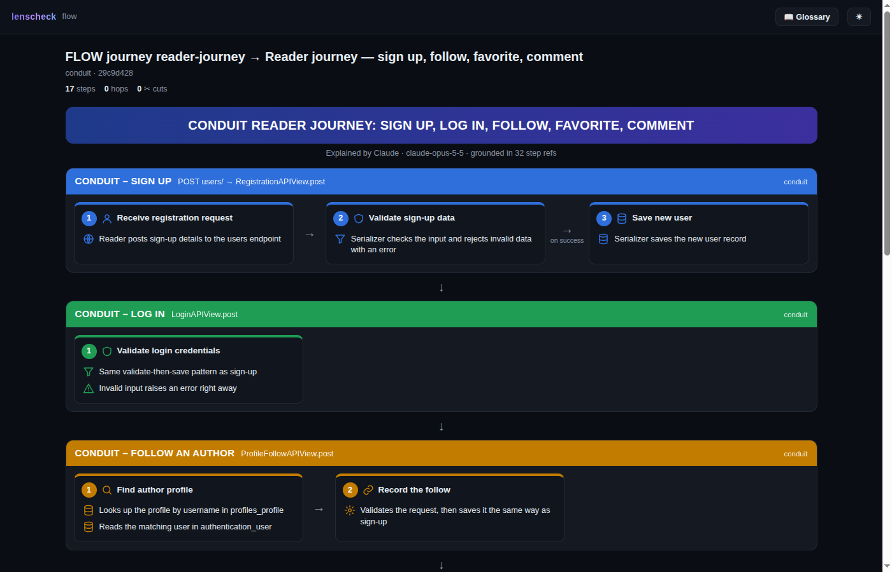

<a href="https://warriorwhocodes.com"></a>

<p align="center">
  <a href="https://ankushsinghgandhi.github.io">
    
  </a>
  <a href="http://twitter.com/ankushsgandhi">
    
  </a>
   <a href="https://www.linkedin.com/in/ankush-singh-gandhi-2487771aa/">
    
  </a>
  <a href="https://dev.to/@ankushsinghgandhi">
    
  </a>
  <a href="https://stackoverflow.com/users/13790266/ankush-singh">
    
  </a>
  <a href="https://leetcode.com/ankushsinghgandhi/">
    
  </a>
    <a href="https://www.hackerrank.com/ankushsgandhi">
    
  </a>
    <a href="https://www.hackerearth.com/@bhanusinghank">
    
  </a>
</p>


# /flow — a Claude Code skill for `lenscheck flow`

Ask Claude *"how does X work end to end?"* and get an interactive infographic of the feature in your
Python web repo (Django / Flask / FastAPI): business stages, the tables each step reads and writes, branches,
cross-repo hand-offs, and the source behind every line on click.

**lenscheck finds, Claude explains, the page draws.** The trace is static and deterministic (AST, no LLM);
Claude only writes the overview, and every line it writes must cite a traced step or it is marked unverified.



*`/flow reader journey` on the public [RealWorld Django app](https://github.com/gothinkster/django-realworld-example-app):
one band per step, the tables each one touches, and every line grounded in a traced step.*

## Install

First the lenscheck CLI (the flow commands live on its `flow` branch for now):

```bash
pip install "git+https://github.com/AnkushSinghGandhi/lenscheck-semantic-reviewer@flow"
```

Then install the skill as a Claude Code plugin:

```
/plugin install lenscheck-flow --marketplace AnkushSinghGandhi/lenscheck-flow-skill
```

Or by hand: `git clone https://github.com/AnkushSinghGandhi/lenscheck-flow-skill ~/src/lenscheck-flow-skill`
and `ln -s ~/src/lenscheck-flow-skill/skills/flow ~/.claude/skills/flow`.

`--explain` uses the `claude` CLI with your Claude Code login (no API key).

## Use

On the first run `/flow` asks for your backend repos, frontend repos and (optionally) the app folders to focus
on, and saves them to `$FLOW_JOURNEYS/<project>/repos.yaml`; later runs just confirm them. Extra backend repos become
cross-repo hops, frontend repos tell Claude the order of a multi-step feature, and app folders narrow the search.

```
/flow list                    # catalog of every entrypoint and saved journey
/flow lead upload             # one API, command or task
/flow campaign creation       # a multi-step feature: Claude drafts a journey YAML, you approve it
```

| env var | default | what |
|---|---|---|
| `LENSCHECK` | `lenscheck` | how to run the CLI, e.g. `python3 ~/src/lenscheck/cli.py` |
| `FLOW_JOURNEYS` | `~/.lenscheck/journeys` | where approved journey YAMLs are saved |

Pages go to `~/.cache/lenscheck/flows/<repo>/`. They embed your source code, so keep them out of git.

## Privacy

- **Without `--explain`** everything runs locally: lenscheck only parses your code (it never imports or runs it),
  and the page is a single offline HTML file.
- **With `--explain`** one `claude -p` call sends a text digest of the flow to Anthropic through your Claude Code
  login: the steps, guards and table names, docstrings, and a few lines of code around each DB / external step.
  It runs with every tool disabled, from an empty temp folder, so it cannot read anything else in your repo.
  The answer is cached; a flow is only re-sent when its code changes.
- If your code may not leave your machine, skip `--explain`; the facts-only overview needs no network.
